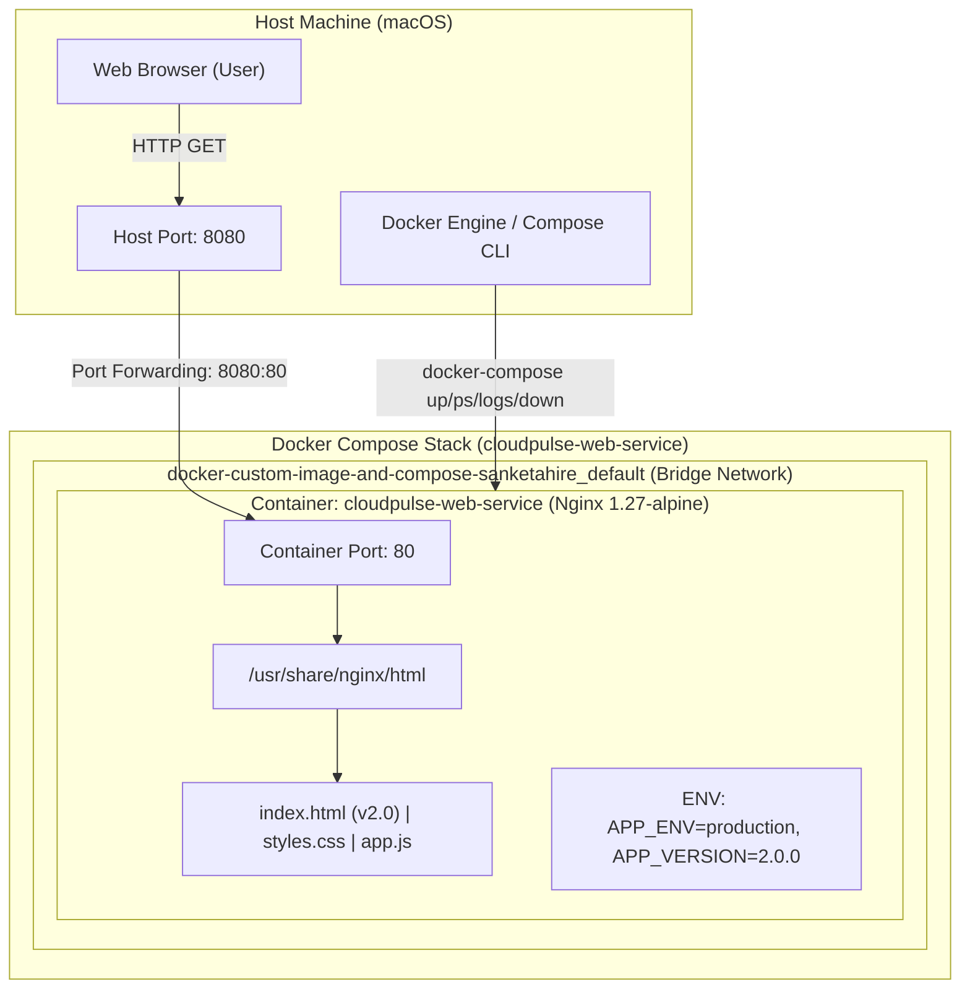
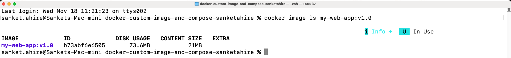
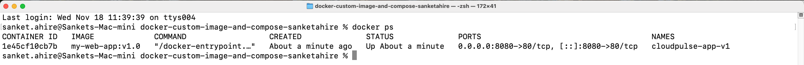
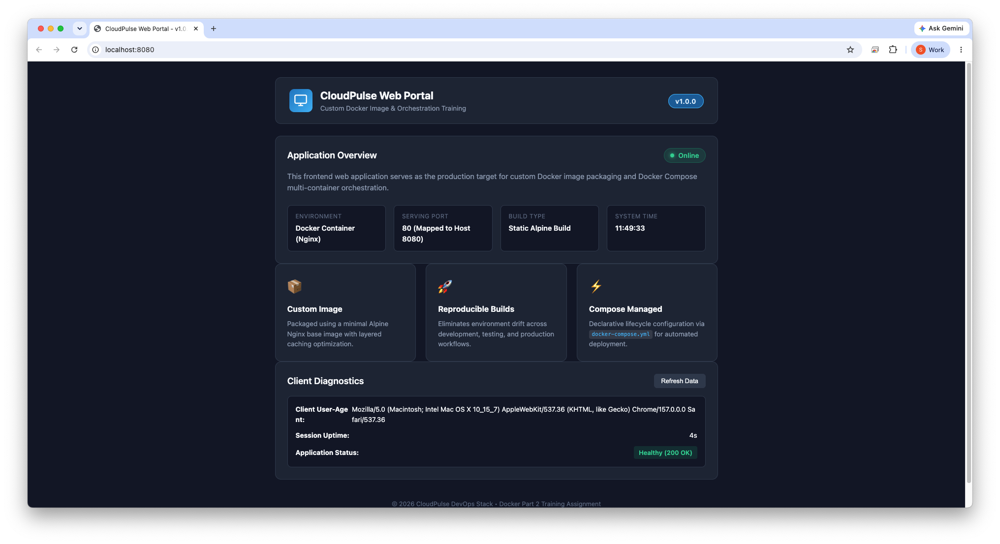
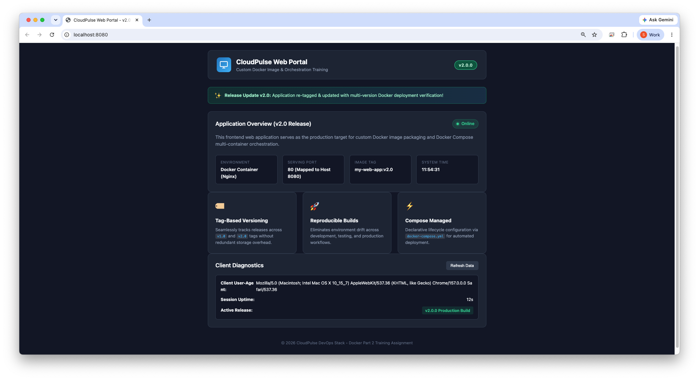
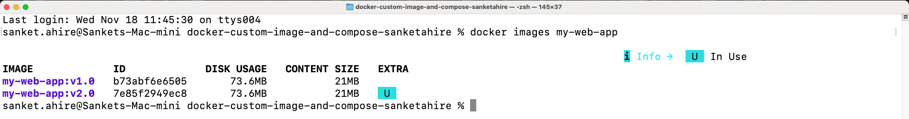
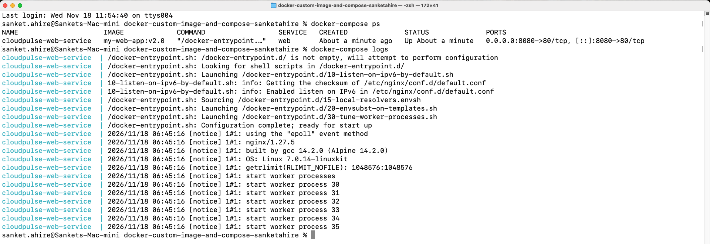
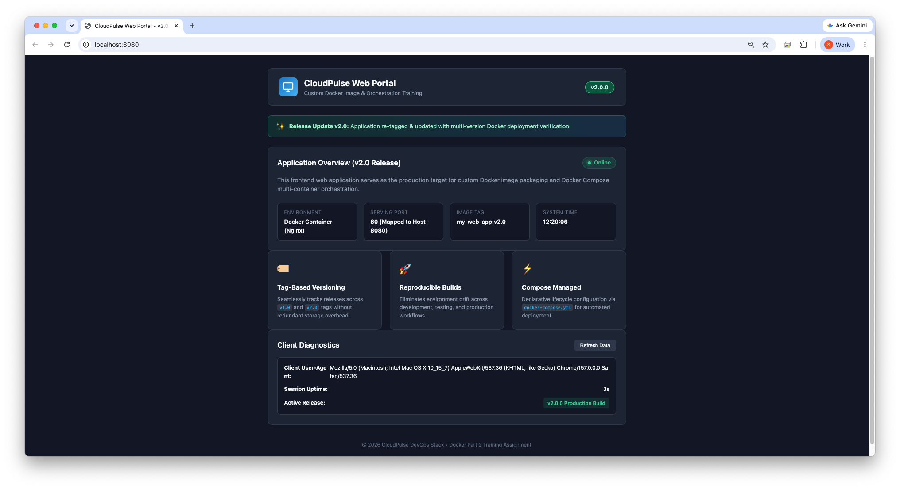

# CloudPulse Web Portal &bull; Docker Containerization &amp; Orchestration

[](https://www.docker.com/)
[](https://docs.docker.com/compose/)
[](https://hub.docker.com/_/nginx)
[](https://hub.docker.com/_/nginx)

---

## Executive Summary

In Part 1 of the Docker training, the application directly depended on a generic, pre-built Nginx image via runtime directory mounts. This presented reproducibility, immutability, and environmental drift challenges across development, testing, and production workflows.

This repository provides the complete, production-grade solution for **Docker [Part 2] Training Assignment**:
1. **Custom Image Packaging ([Dockerfile](Dockerfile)):** Packaging a responsive frontend application into a custom, self-contained Docker image using an official, minimal **Alpine Linux** base image (`nginx:1.27-alpine`), reducing content size to just **21MB**.
2. **Context & Layer Cache Optimization ([.dockerignore](.dockerignore)):** Streamlining build context transfer and structuring instructions to leverage Docker's layer cache for near-instant rebuilds.
3. **Multi-Version Tagging Strategy:** Demonstrating deterministic image versioning across `v1.0` and `v2.0` releases.
4. **Declarative Service Orchestration ([docker-compose.yml](docker-compose.yml)):** Replacing manual, error-prone CLI commands with Infrastructure-as-Code (IaC) to manage application services, port bindings, environment variables, and restart policies.

---

## Architecture Overview



---

## Project Structure

```text
docker-custom-image-and-compose-sanketahire/
├── .dockerignore                     # Filters build context (ignores .git, docs, screenshots)
├── .gitignore                        # Git exclusion rules (OS & IDE metadata)
├── Dockerfile                        # Multi-layer Alpine Nginx image specification (Task 1)
├── docker-compose.yml                # Declarative service specification (Task 3)
├── index.html                        # Application markup (v2.0.0 production build)
├── styles.css                        # Modern responsive dark-theme styling
├── app.js                            # Interactive client logic & live diagnostics
├── docs/                             # Official training reference documents
│   ├── Training.Assignment.Docker.Part2.pdf
│   └── Training.Material.Docker.Part2.pdf
├── screenshots/                      # Deliverable evidence suite (Deliverable #3)
│   ├── 01-custom-image-built-successfully.png
│   ├── 02-application-running-inside-docker.png
│   ├── 03-application-accessible-browser-v1.png
│   ├── 04-application-updated-browser-v2.png
│   ├── 05-docker-images-multitag-v1-v2.png
│   ├── 06-docker-compose-service-running.png
│   └── 07-application-accessible-after-restart.png
└── README.md                         # Comprehensive documentation & command reference
```

---

## Core Docker Principles Applied

### 1. Official & Minimal Base Image (Best Practices #1 & #2)
Rather than using a generic full-OS image like `ubuntu:24.04` (which weighs several hundred megabytes), we selected `nginx:1.27-alpine`. This pinned Alpine image produces an ultra-lean **21MB content size**, minimizing attack vectors and drastically accelerating download and deployment speeds.

### 2. Build Context Optimization (Best Practice #6)
Using [.dockerignore](.dockerignore), non-essential assets (such as `.git/`, documentation PDFs, screenshots, and `.DS_Store`) are excluded before the context is transferred to the Docker daemon. This guarantees fast context transmission and prevents sensitive files from leaking into the container image.

### 3. Layer Caching & Build Acceleration
Instructions are organized from least-frequently changing to most-frequently changing. During the `v2.0` rebuild, base layers (`WORKDIR`, `RUN rm -rf ./*`) were fully cached (`✓ Cached`), allowing the rebuild to finish in just **1.9 seconds**.

### 4. Tag-Based Version Evolution
Instead of using the ambiguous `latest` tag, we adopted semantic version tags:
* `my-web-app:v1.0`: Initial baseline release.
* `my-web-app:v2.0`: Updated release with the `v2.0.0` banner and enhanced telemetry.
Both tags share common underlying layers on disk without redundant storage bloat.

### 5. Infrastructure-as-Code via Docker Compose
All runtime settings (port bindings, build paths, container naming, environment variables, restart policies) are codified in [docker-compose.yml](docker-compose.yml), enabling single-command lifecycle management (`docker-compose up -d`).

---

## Deliverable #4: Complete Command Reference Table

Below is the comprehensive, categorized list of all Docker and Docker Compose commands executed and verified during this assignment:

| Category | Command | Flags / Arguments | Description & Operational Purpose |
| :--- | :--- | :--- | :--- |
| **Image Building** | `docker build` | `-t my-web-app:v1.0 .` | Builds the custom image from `Dockerfile` using the current directory (`.`) as build context and assigns the version tag `v1.0`. |
| **Image Building** | `docker build` | `-t my-web-app:v2.0 .` | Rebuilds the updated application with tag `v2.0`, leveraging cached base layers for ultra-fast compilation. |
| **Image Inspection** | `docker image ls` | `my-web-app:v1.0` | Lists local repository images, verifying image ID, tag, creation time, and virtual disk footprint. |
| **Image Inspection** | `docker images` | `my-web-app` | Verifies multi-version coexistence, demonstrating that `v1.0` and `v2.0` exist concurrently on the host. |
| **Container Execution** | `docker run` | `-d -p 8080:80 --name cloudpulse-app-v1 my-web-app:v1.0` | Instantiates a container in background/detached mode (`-d`), binds host port 8080 to container port 80 (`-p`), assigns a custom container name, and executes `v1.0`. |
| **Container Execution** | `docker run` | `-d -p 8080:80 --name cloudpulse-app-v2 my-web-app:v2.0` | Launches the updated `v2.0` container on port 8080 for verification. |
| **Process Inspection** | `docker ps` | *(none)* | Displays active running containers, status (`Up`), port forwarding rules, and container IDs. |
| **Container Management** | `docker stop` | `cloudpulse-app-v1` | Sends `SIGTERM` to gracefully shut down the running container process. |
| **Container Management** | `docker rm` | `cloudpulse-app-v1` | Removes the stopped container filesystem to release container name and host port bindings. |
| **Compose Validation** | `docker-compose config` | *(none)* | Parses and validates the YAML syntax, indentation hierarchy, and configuration schema of `docker-compose.yml`. |
| **Compose Lifecycle** | `docker-compose up` | `-d --build` | Builds the service image from source context and starts the service stack in detached mode (`-d`). |
| **Compose Inspection** | `docker-compose ps` | *(none)* | Lists status of containers managed by the current Compose stack, verifying service names and published ports. |
| **Compose Logging** | `docker-compose logs` | `--tail=20` | Streams the stdout/stderr log output of the containerized services to verify runtime health. |
| **Compose Lifecycle** | `docker-compose stop` | *(none)* | Suspends active service containers while keeping networks, volumes, and configurations intact. |
| **Compose Lifecycle** | `docker-compose start` | *(none)* | Restarts previously stopped service containers, restoring live application accessibility. |
| **Compose Teardown** | `docker-compose down` | *(none)* | Gracefully stops running services, deletes containers, and tears down the default virtual bridge network. |

---

## Step-by-Step Reproduction Guide

### Prerequisites
* Docker Engine 24.0+ / Docker Desktop running.
* Docker Compose v2.0+.

### Option 1: Quickstart via Docker Compose (Recommended)
```bash
# 1. Clone the repository
git clone git@github.com:rsllearning/docker-custom-image-and-compose-sanketahire.git
cd docker-custom-image-and-compose-sanketahire

# 2. Build and launch the stack in detached mode
docker-compose up -d --build

# 3. Check service status
docker-compose ps

# 4. View service logs
docker-compose logs

# 5. Open in browser
# Navigate to: http://localhost:8080

# 6. Teardown stack when finished
docker-compose down
```

### Option 2: Manual Execution via Docker CLI
```bash
# 1. Build the custom image
docker build -t my-web-app:v2.0 .

# 2. Run the container with port mapping
docker run -d -p 8080:80 --name cloudpulse-app my-web-app:v2.0

# 3. Verify running container
docker ps

# 4. Stop and remove container
docker stop cloudpulse-app && docker rm cloudpulse-app
```

---

## Deliverables & Evidence Gallery

### Deliverable 1: Production Dockerfile
* **File:** [Dockerfile](Dockerfile)
* **Highlights:** `nginx:1.27-alpine` base, clean document root initialization, explicit asset copy, `EXPOSE 80`, foreground execution.

### Deliverable 2: Docker Compose Configuration
* **File:** [docker-compose.yml](docker-compose.yml)
* **Highlights:** Service definition `web`, build context, image tag `v2.0`, port mapping `"8080:80"`, environment variables, restart policy `unless-stopped`.

### Deliverable 3: Screenshot Evidence Suite

#### 1. Custom Image Built Successfully (Task 2)
> Verifies that `docker build -t my-web-app:v1.0 .` completed successfully and registered an optimized 21MB image.


#### 2. Application Running Inside Docker (Task 2)
> Verifies `docker ps` showing container `cloudpulse-app-v1` active on port mapping `0.0.0.0:8080->80/tcp`.


#### 3. Application Accessible Through Browser - v1.0.0 (Task 2)
> Verifies browser access at `http://localhost:8080` displaying the baseline `v1.0.0` CloudPulse Web Portal.


#### 4. Application Updated & Accessible - v2.0.0 (Task 2)
> Verifies browser rendering of the re-tagged `v2.0.0` build with the new release update banner.


#### 5. Multi-Version Image Tags Coexistence (Task 2)
> Verifies `docker images` demonstrating that both `my-web-app:v1.0` and `my-web-app:v2.0` coexist on the host.


#### 6. Docker Compose Service Running & Logs (Task 4)
> Verifies `docker-compose ps` showing service `web` (`cloudpulse-web-service`) active on port 8080 along with `docker-compose logs`.


#### 7. Application Accessible After Restart (Task 4)
> Verifies that the application remains fully accessible at `http://localhost:8080` following `docker-compose stop` and `docker-compose start`.


---

## Assignment Compliance Matrix

| Assignment Requirement | Deliverable Output | Compliance Status |
| :--- | :--- | :--- |
| **Task 1: Create a Dockerfile** | [Dockerfile](Dockerfile) & [.dockerignore](.dockerignore) | **100% Complete** |
| **Task 2: Build & Run Custom Image** | Multi-tag build (`v1.0`, `v2.0`), container port mapping, browser verification | **100% Complete** |
| **Task 3: Docker Compose Configuration** | [docker-compose.yml](docker-compose.yml) (services, build, ports, env, restart) | **100% Complete** |
| **Task 4: Compose Lifecycle Operations** | `up -d --build`, `ps`, `logs`, `stop`, `start`, browser re-check, `down` | **100% Complete** |
| **Deliverable 1: Dockerfile** | [Dockerfile](Dockerfile) | **Delivered** |
| **Deliverable 2: docker-compose.yml** | [docker-compose.yml](docker-compose.yml) | **Delivered** |
| **Deliverable 3: Screenshot Suite** | 7 high-resolution screenshots in [screenshots/](screenshots/) | **Delivered** |
| **Deliverable 4: Commands List** | Comprehensive categorized command reference table | **Delivered** |
